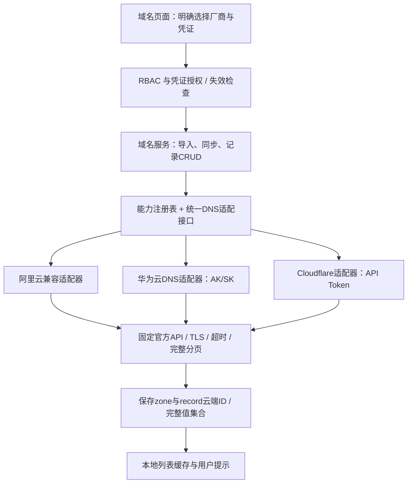

# 华为云 / Cloudflare 域名管理与统一适配层

用户已选择：先统一域名适配层；主机、证书和费用模块只评估，不做全站云账号重构。继续使用 `codex/huawei-cloud-import` 分支。

## 实现前架构

## 安全审计

现状：厂商注册表仅有展示元数据；仅阿里云真正同步，其他厂商扫描返回示例域名，解析写操作只写本地。账号厂商依赖凭证名称猜测；没有保存云端记录ID；华为云多值记录集和Cloudflare代理/TTL语义均未建模。

接入要求：

- 导入明确选择provider + credential_id；不能用凭证名字当权威身份。保留旧调用推断的兼容入口，但不返回示例数据。
- 云域名写操作先校验凭证权限及云端Zone归属，记录ID必须属于该Zone。远程失败不修改本地记录；部分分页失败不清理本地缓存。
- 华为云记录集按一个云端ID保存全部值；Cloudflare保留代理开关、TTL=1自动值、MX优先级；未知或系统记录只读，不能丢掉再同步删除。
- 固定官方端点、TLS验证、禁重定向、超时、分页上限、错误脱敏。
- DNS删除沿用 domains:delete 一次性风险票据，不增设绕过。域名资产移除仅移除本地纳管，不删除云端Zone。
- ACME/证书部署不在本次范围；注册表与UI只宣称实际实现的能力，不因为支持DNS就误称支持证书。
- 全部云操作只通过测试替身验证，真实DNS写入需要专门测试域名，避免修改用户生产解析。

## 文件与步骤

- [x] 1. `backend/tests/test_dns_providers.py` / `test_domain_provider_routes.py` 先写行为测试并观察缺失功能失败。
- [x] 2. 新建 `backend/app/services/dns_providers/`：协议、注册表、Cloudflare、华为云、阿里云兼容适配；完整分页、标准记录语义、脱敏异常。
- [x] 3. 新建 `backend/app/services/domain_resources.py` 统一编排；修改 `api/domains.py` 复用入口，新增显式刷新，云端归属检查与原子缓存同步。
- [x] 4. 模型和幂等迁移：域名remote zone ID；记录remote ID、完整值JSON、代理、MX优先级、只读标志。历史255字符列保留，完整长TXT写入新Text列，避免开发库类型变更不生效。
- [x] 5. 前端接入后端能力元数据，添加云域名导入Drawer、凭证类型筛选、刷新和错误展示；华为云多值、Cloudflare代理/自动TTL、MX优先级编辑与只读控制。
- [x] 6. 全量检查、Vitest、真实浏览器操作（模拟云API）、独立代码审查；形成开发记录和其他云资源模块扩展性评估。

## 验证标准

两家厂商通过真实协议适配而不是示例数据返回；未授权凭证在任何缓存状态下不能读写云域名；非本域名的remote ID不能被修改；多页完整同步后才删除过期缓存；华为云多值记录集更新不丢值；Cloudflare自动TTL和代理不被普通保存意外覆盖；删除保留票据守卫；现有阿里云与自定义本地域名继续可用。
