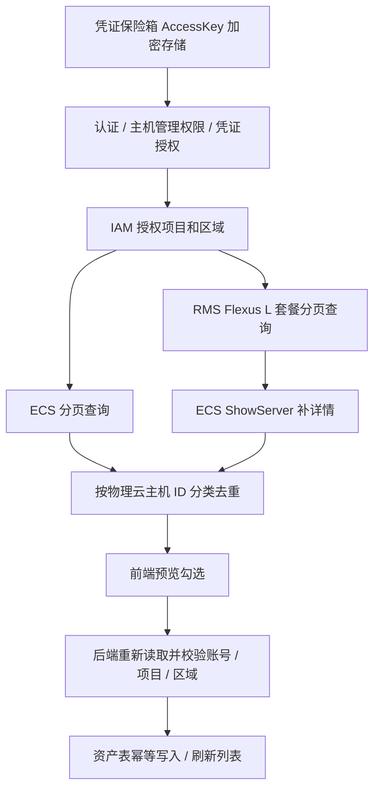

# 华为云 ECS / Flexus L 导入实现计划

**目标：** 沿用凭证保险箱保存华为云 AK/SK，在主机页扫描、预览、勾选导入 ECS 与 Flexus L。

**架构：** 前端传凭证 ID，后端授权并解密，IAM 获取授权项目，ECS 分页查询；RMS 查询 `hcss.l-instance`，按套餐内物理云主机 ID 补 ECS 详情并分类去重。扫描只读，导入重新查询云端，确认身份后写入现有资产表。

**安全审计（实现前）：**

- 已有凭证加密和授权组校验可复用，前端不读取已保存密钥。
- AK/SK 日期在本项目明确为预警用途，保留既有长期有效约定；明确标记 expired 的凭证拒绝使用。
- 不接受自定义云 API 地址，使用 SDK 内置官方端点；启用 TLS 校验、超时、分页上限；不追随 API 返回的任意 next URL。
- SDK 原始异常不回传客户端，不保存/打印 AK/SK 或原始响应中的敏感属性。
- 资产补账号和项目身份字段，禁止不同厂商/账号/项目的同 ID 资产被覆盖；轮换凭证但同账号允许更新。
- 云 API 只读，不涉及云端开关机/删除。导入只变更本地资产，沿用 manage 权限；新高危路由若引入另走风险票据。
- SSH 凭证独立绑定，导入不触发 SSH 登录。

**文件职责：**

- `backend/app/services/huawei_cloud.py`：SDK 客户端、授权项目、ECS/RMS 分页、字段映射与安全错误。
- `backend/app/services/huawei_asset_sync.py`：预览与导入，资产身份冲突检查。
- `backend/app/api/assets.py`：注册 huawei，复用入口和凭证解析。
- `backend/app/models/asset.py`、`backend/alembic/versions/`：云账号 / 项目身份字段。
- `backend/requirements.txt`：固定华为云 core/ecs/iam/rms SDK 版本。
- `frontend/src/types/api.ts`、`frontend/src/pages/assets/hosts/index.tsx`：华为云选项、轻量分类、跨 Tab 勾选、错误提示。
- `frontend/src/pages/assets/credentials/index.tsx`：AK/SK 输入示例兼容华为云。
- `backend/tests/test_huawei_cloud_contract.py`：分页、项目、分类、失败、授权、预览无写入、幂等与冲突测试。

## 执行步骤

- [x] 1. 编写后端行为测试，在 backend 目录运行 `.venv/Scripts/python.exe -m pytest tests/test_huawei_cloud_contract.py -q`，确认因功能缺失失败。
- [x] 2. 实现 SDK 适配与导入服务、资产身份迁移和接口分支，重复运行同一测试直到通过。
- [x] 3. 接通前端华为云入口和两类预览；保留其他云厂商行为，修复跨 Tab 勾选覆盖与扫描失败统计。
- [x] 4. 运行 `scripts/run_checks.py`、前端 vitest；使用 Playwright 操作保存凭证、扫描两类主机、跨 Tab 勾选和导入。浏览器使用模拟云 API，明确区分真实华为云联调。
- [x] 5. 更新页面开发记录，附验证结果与尚需真实凭证联调的限制。

**验收：** ECS 与 Flexus L 在正确 Tab 出现并可同时选中导入；同一轻量主机仅出现一次；重复导入不新增；部分失败不能显示完全成功；无权/失效凭证不能解密调用 SDK；其他云厂商回归与构建通过。
