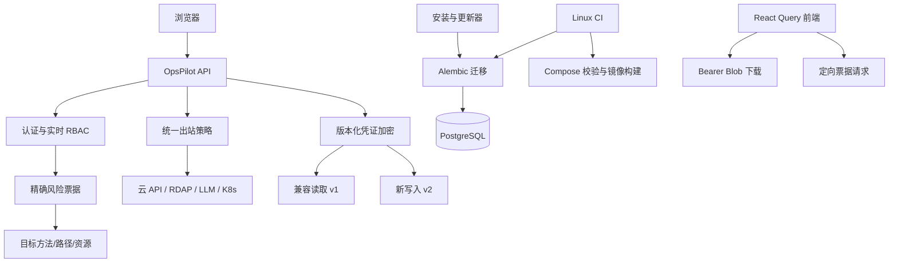

# OpsPilot 全量评审整改设计

## 1. 目标与范围

本规格覆盖 2026-11-05 代码评审报告中尚未完成或仅部分完成的整改项，按风险和依赖拆为四批：

1. 安全与数据边界：风险票据、凭证加密、JWT、下载鉴权、SSRF、登录与审计、高危操作。
2. 数据库与部署：完整 Alembic、安装与增量更新、监控暴露面、Compose/Dockerfile/CI。
3. 前端可靠性：票据定向传递、认证一致性、缓存、重复回调、筛选、下载和交互规范。
4. 工程治理：测试隔离、关键链路测试、静态门禁、模块拆分、异常和时间 API、依赖与警告清理。

不改变现有业务功能、权限键语义、云厂商能力和页面视觉风格。任何安全收紧都必须提供明确错误，不能把失败静默转换为空值或“安装成功”。

## 2. 总体架构

设计原则：

- 授权、票据、资源身份三者必须同时匹配。
- 密钥和 schema 迁移必须向后兼容、可观测、可中断。
- 出站访问默认拒绝危险目标，企业私网例外必须显式配置。
- 安装、更新、审计和后台任务不得报告虚假成功。
- 前端缓存键、认证失败和高危确认只有一条权威路径。

## 3. 第一批：安全与数据边界

### 3.1 风险票据 v2

风险票据只存规范化全权限键，不再存短键前缀。`POST /api/auth/risk-challenge` 仍兼容现有 `action_key`，但服务端必须将短键解析为调用者有权执行且唯一的 `(permission_key, action_id)`；解析为零项或多项时返回 422，前端改用全键请求。

票据增加并校验：

- `http_method`：业务请求方法。
- `route_template`：FastAPI 路由模板，而非带查询串的原始 URL。
- `resource_id`：单资源操作必填；批量操作使用排序、去重后的资源 ID 列表摘要。
- `request_digest`：对动作关键字段做规范化 JSON SHA-256，防止确认后替换目标。

消费顺序为实时 RBAC、票据字段匹配、数据库原子消费。任何一项失败不得消费票据。为兼容滚动升级，旧票据在部署后立即失效，TTL 仅 120 秒，不做数据库迁移兼容。

所有高危入口使用显式 `fetchRiskTicket`，请求调用方直接携带 `X-Risk-Ticket`；删除“下一个任意 axios 请求”槽位。SSH 命令、Pod exec、数据库执行、采集器卸载、应用组件启停/批删和通知清空按现有风险矩阵注册并由后端强制消费票据。

### 3.2 版本化凭证加密

`CREDENTIAL_ENCRYPTION_KEY` 变为必填且不得等于 `SECRET_KEY`。新密文格式为 `enc::v2::<salt>::<token>`：

- 使用 HKDF-SHA256，从独立主密钥、随机 salt 和固定用途标签 `opspilot/credential/v2` 派生 Fernet 密钥。
- 旧 `enc::<token>` 继续用历史 SHA-256 派生规则读取，但只能使用显式凭证密钥；不再回退 JWT 密钥。
- 成功读取旧密文后，在有写事务的凭证使用/编辑路径进行惰性重加密；另提供一次性批量迁移命令。
- 无法解密抛出专用 `CredentialDecryptionError`，API 转为不泄露密文的 422/503，后台任务记录凭证 ID 和业务上下文，不记录秘密。

启动检查只验证配置存在和相互独立，不尝试扫描、解密或打印全部凭证。

### 3.3 JWT 与登录

JWT 实现迁移到 PyJWT，所有 decode 明确限定单一算法并校验必要 claims。访问令牌默认 60 分钟；新增轮换 refresh token，数据库仅保存 refresh token 哈希、用户、过期时间、撤销时间和 token_version。改密、禁用和显式注销继续依赖 `token_version` 撤销全部会话。

登录限流默认使用 `request.client.host`。只有请求来自 `TRUSTED_PROXY_CIDRS` 时才读取标准化的 `X-Forwarded-For` 最右侧可信链；多实例计数存数据库并设置到期清理。不存在的用户也对固定假哈希执行密码校验，消除明显时序差。

Bootstrap 管理员仅在账号不存在时创建；已存在账号绝不改角色、状态、权限覆盖或密码。初始化密码复用统一密码策略，弱密码使启动失败并给出不含密码的错误。

### 3.4 统一出站访问策略

新增小型 `outbound_policy` 服务，负责 URL 规范化、DNS 解析、重定向逐跳校验、响应体上限和超时。策略按场景配置：

- LLM：默认仅 HTTPS；公共提供商使用内置域名，企业网关通过 `LLM_TRUSTED_HOSTS` 显式允许。禁止 URL 用户信息和非 HTTP(S) scheme。
- Kubeconfig scan：只允许 HTTPS；私网集群通过 `K8S_SCAN_ALLOWED_CIDRS` 显式允许；始终禁止云元数据地址、环回和链路本地地址。错误只返回分类提示，底层 TLS/连接细节写受控日志。
- RDAP：禁用自动重定向，手动逐跳校验 HTTPS 和 RDAP bootstrap 允许域名；限制跳数与响应大小。

DNS 解析后连接前必须再次校验最终 IP，降低 DNS rebinding 风险。

### 3.5 审计和小型安全缺口

- 审计写库使用独立 try/except/rollback；失败写 error 日志和指标，不覆盖业务响应。
- 审计身份复用统一 token 校验，风险原因去控制字符并限制 500 字符。
- `/api/log_error` 要求登录、限制字段长度并结构化记录。
- Webhook token 使用 `hmac.compare_digest`。
- PostgreSQL 布尔回滚 SQL 输出 `TRUE/FALSE`，MySQL 输出 `1/0`。
- 高敏 GET 下载纳入审计规则。
- 四处下载统一走 axios Blob 和 `downloadBlob`，不把长期 token 放进 URL。

## 4. 第二批：数据库与部署

### 4.1 Alembic 权威化

以最后一个可确认的生产 revision 为起点，建立“历史 schema fixture → upgrade head → 与 ORM 元数据逐表逐列比较”的测试。新增迁移只创建存量库缺失的表、列、索引、外键和约束，并使用 inspector 实现幂等保护；不得通过 `stamp head` 掩盖缺口。

空库仍从 `0001` 升级，存量 fixture 覆盖报告点名的域名 DNS、数据库管理、费用、WireGuard、部署、告警和根因分析表。数据迁移先复制/回填再加约束，失败时事务回滚。

离线 `init-db` 和增量更新统一执行 `alembic upgrade head`。`alembic_version` 宽度兼容只留在 Alembic `env.py`。生产 `DB_AUTO_CREATE_TABLES=0`；开发补列逻辑只作为本地兼容并在发现漂移时暴露 unhealthy 状态。

### 4.2 安装与更新

- 任一必需服务健康检查失败，安装器汇总失败并以非零退出，绝不打印“安装完成”。
- `--config` 先校验必填字段、URL、端口、网段和密码强度；覆盖旧配置前生成 0600 备份。
- 管理员和 Grafana 随机密码不少于 24 个可打印字符，首次登录强制改管理员密码。
- `package.sh` 生成单一版本 manifest；安装器从 manifest 读取应用与监控镜像 tag 和 SHA-256，不再写死 1.0.0。
- `INSTALL_DIR` 真正用于安装产物目录；检查 Docker/Compose 最低版本、磁盘和内存。
- 增量更新先迁移、再滚动启动、再健康检查；失败恢复旧镜像 tag，schema 只允许向前兼容迁移。

### 4.3 网络与容器

Grafana 保持已完成的专用网络和代理白名单。VM、VLogs、Alloy 默认只绑定回环或内部网络；分体部署必须显式指定私网绑定和防火墙来源。Alloy 增加 healthcheck，VM 抓取监控栈自身指标并提供失联/磁盘水位告警。

开发与离线监控共用同一镜像版本变量和配置基线。VM/VLogs 设置最大磁盘占用；全部服务配置日志轮转、合理 CPU/内存限制和 restart 策略。

后端和前端 Dockerfile 使用钉死补丁版本的多阶段构建、非 root 运行和 HEALTHCHECK。仅允许构建所需的 pnpm lifecycle 包，不使用 `dangerouslyAllowAllBuilds`。

### 4.4 CI 与配置

CI 增加 Linux PostgreSQL job，验证空库和存量库升级、`alembic check`、四份 Compose、镜像构建、秘密扫描、pip/npm 高危漏洞报告。迁移验证脚本使用 `sys.executable`，要求临时数据库前缀和显式测试实例，拒绝生产库名与非本机/CI 数据库。

建立唯一部署环境变量目录文档；根、后端和离线样例由同一校验脚本检查必需键。生产通知 `CONSOLE_URL` 必填。配置拼写错误在启动摘要中报告，摘要必须脱敏。

破坏性 Alembic downgrade 默认拒绝执行，只有显式确认已完成 `pg_dump` 并提供备份路径时才放行。资产密码历史迁移增加数据库完成标记，成功后不再每次启动扫描全表。根 Compose 缺少后端 `.env` 时输出明确复制指令，而不是底层文件不存在错误。

## 5. 第三批：前端可靠性

- `authenticatedFetch` 对 401 执行与 axios 相同的 logout/跳转，并支持 AbortSignal 和调用方超时。
- 下载 API 统一返回 Blob；终端、DB 回滚、WireGuard 配置、账单 CSV 共用下载工具。
- React Query 键集中定义；管理页变更同时失效列表和资源绑定查询，或直接复用同一键前缀。
- `DeploymentProgressModal` 使用 ref 保证成功回调每个 task_id 只执行一次。
- 域名、证书分组筛选下沉服务端；域名编辑完整回填 ACME 凭证，厂商/账户由后端原子换绑。
- 域名统计先判空再比较；主机统计改用服务端聚合，删除挂载时重复的全量资产请求。
- AI 流式请求卸载时 abort；日志表启用分页或虚拟滚动。
- 无权限操作入口条件渲染；删除统一为一次普通确认加一次风险确认，不重复弹框。
- 创建命名空间、WireGuard 成员和 SSH 凭证表单按项目规范改为 Drawer + Form。
- 静态 antd API 改为 `App.useApp()`；删除死页面和死 store。
- 轮询 403 只保留单一提示并停止无权限查询；通知乐观更新失败回滚，本地通知设置数量和 TTL 上限。
- 长操作按 API 单独设置超时；类型导入和 API 调用改为静态、具名类型。
- 页面不再绕过 `api/index.ts` 直接发业务请求；应用移出分组等待结果、处理错误并失效成员缓存。
- 凭证权限组下拉只显示名称；明文批量导出按勾选项执行，无选择时拒绝；删除残留教学句。

页面视觉不新增色彩、卡片或教学文案，仅修复行为和规范一致性。

## 6. 第四批：工程治理

### 6.1 测试

- E2E 使用临时 PostgreSQL/隔离 schema、随机管理员和真实 ASGI 栈，不读取开发 `.env` 或硬编码密码。
- ACME 客户端依赖注入，覆盖签发成功、challenge 失败、续签和并发占用。
- DB 工单增加真实 PostgreSQL/MySQL 驱动契约容器测试，覆盖备份、执行、失败和回滚 SQL。
- Finance 测试走完整 ASGI 鉴权和中间件。
- Alloy 三份配置增加关键段一致性契约。
- 用户管理、权限管理、数据库工单增加 RBAC 组件测试。
- 变更工单等关键状态机使用真实 SQLAlchemy Session 和隔离数据库，Fake 只保留在云 API、SSH、邮件等外部边界。

### 6.2 静态质量和模块边界

禁止业务模块星号导入，ruff/pyflakes 门禁覆盖 F403/F405 和未定义名。注册式导入仅在明确目录豁免。

按职责拆分 `ai_agent.py`、`assets.py`、`monitoring/routes.py`，优先抽出纯服务与 schema，保持路由和响应契约不变。`sync_assets` 按云厂商调用已有 provider 服务；集群健康摘要和告警派发抽聚合服务。每次拆分一个域并运行对应契约测试，禁止纯粹为了行数进行跨域重写。

DNS 操作以现有 `dns_providers` 注册表为唯一新增入口；旧阿里云并行函数迁入适配器或删除，厂商只实现“请求一页”和“归一化记录”。

业务同步/计费路径不允许裸 `except Exception: pass`；解析回退可以捕获具体异常并注明原因。时间统一为 timezone-aware UTC。清理未用依赖、两个部署占位实现、重复函数、死 import/变量和 ESLint hooks warning。调度器裸数字改具名常量或关键字参数。

进程内会话仍可使用带锁缓存；需要跨 worker 一致性的 DNS 节流和同步任务状态迁入数据库租约/任务表。

前端发布以 `pnpm-lock.yaml` 为唯一解析基线，并在发布文档明确 frozen lockfile 约束；直接依赖采用精确版本写入，升级通过独立依赖提交完成。CI 先记录覆盖率基线，再对认证、用户、数据库工单和部署模块设置不可下降门槛。

## 7. 错误处理和可观测性

所有安全拒绝返回稳定错误码和中文操作提示，不回传底层网络、密文、Token、SQL 密码或 Kubeconfig 内容。后台任务错误包含任务键、资源 ID、阶段和可重试性。安装器输出最终服务矩阵：成功、失败、未安装；任一必需项失败则整体失败。

新增指标至少覆盖：审计写入失败、凭证解密失败、SSRF 拒绝、风险票据拒绝原因、迁移失败、租约 fail-open、监控栈自身健康。
租约连续 fail-open 达阈值时除 error 日志外创建去重站内告警，恢复后发送恢复事件。

## 8. 验收标准

### 安全

- 短键不能签出歧义票据；票据不能跨方法、路由、资源或请求内容消费。
- 旧密文可读且可迁移；缺失/错误凭证密钥时启动或调用明确失败。
- JWT 全部使用 PyJWT 且算法固定；refresh token 可轮换和撤销。
- 白名单外的 LLM、K8s、RDAP 目标被拒绝，显式允许的企业私网可用。
- 下载、终端、Pod exec 和高危业务动作经过 Bearer、RBAC、风险票据与审计。

### 数据与部署

- 空库及存量 fixture `alembic upgrade head` 后与 ORM schema 一致。
- 离线安装和增量更新不再执行 `create_all + stamp`，迁移失败不启动新版本。
- 默认网络无法从局域网直接访问 Grafana、VM、VLogs、Alloy 管理端口。
- 安装失败返回非零；生成秘密文件均为 0600；日志无明文秘密。

### 前端与工程

- 401、票据、下载、缓存和成功回调的回归测试通过。
- 后端全量、前端 lint/test/build、迁移、Compose、镜像和秘密扫描全部通过。
- 无 F403/F405、未定义名、现有 7 个 hooks warning、两个部署占位实现。
- 拆分后 API 路径、DTO、权限键和响应结构不变。

## 9. 提交与回滚边界

每个独立行为一个提交，四批之间设置全量检查点。加密和 schema 变更先提交兼容读取/迁移能力，再切换写入和部署入口。任何批次失败只回退该批代码；已执行的数据库迁移采用向前修复，不自动执行破坏性 downgrade。当前工作树由 Codex 管理，整改完成前不合并 `main`。
