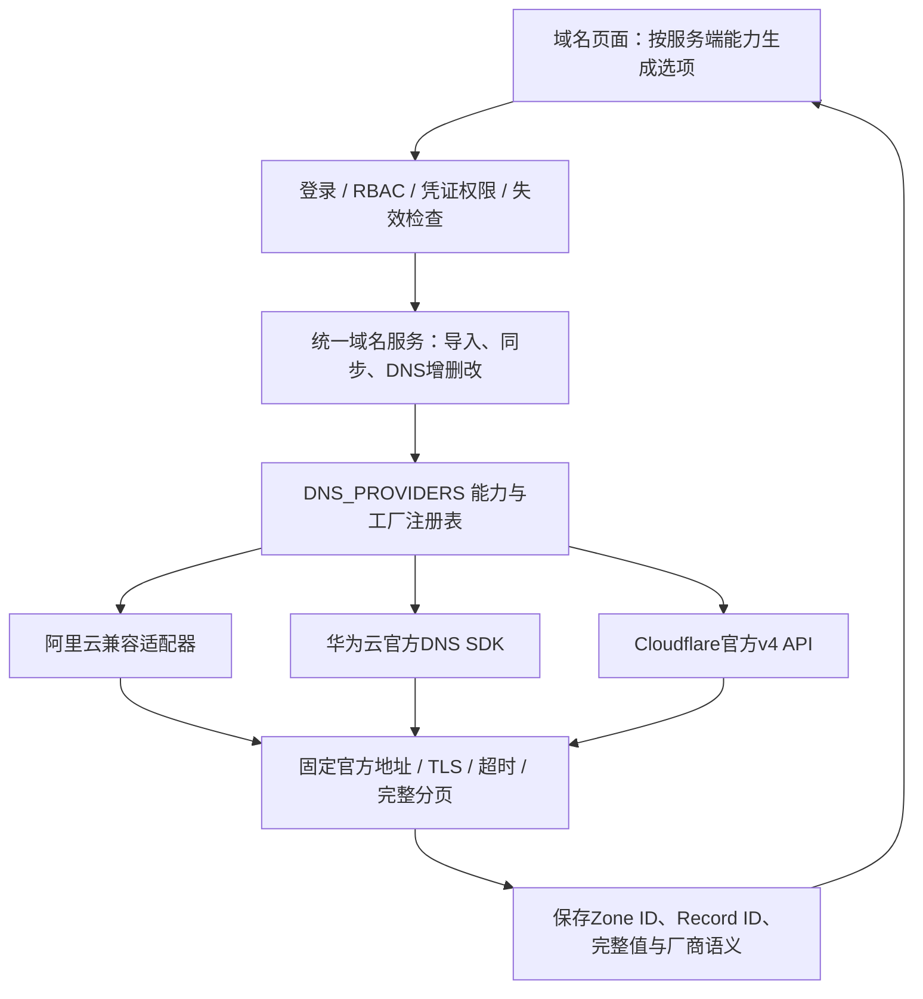

# 华为云与 Cloudflare 域名管理、云资源扩展性评估

日期：2026-11-05。分支：`codex/huawei-cloud-import`。

用户确认的范围：先统一域名适配层并交付两家厂商的域名导入、DNS 记录增删改；主机、证书、费用模块仅评估，不在本次重构全站云账号。

## 实现前架构与安全审计

架构图、已发现风险和执行步骤见 [设计与计划](../../docs/superpowers/plans/2026-11-05-dns-provider-adapters.md)。

原域名模块虽然有华为云、Cloudflare 等厂商名字，但只有阿里云执行真实域名扫描和 DNS 写入。其他厂商的扫描返回示例域名，增删改只更新本地。凭证厂商依赖名称猜测，未保存云端记录 ID，也没有华为云多值记录集、Cloudflare 代理与自动 TTL 的数据语义。

本次删除示例域名回退，并将阿里云、华为云、Cloudflare 纳入统一适配接口。未接入的厂商在能力表中明确不可导入；历史记录仍可展示，不再以本地写入冒充云操作成功。

## 使用入口与支持范围

1. 在凭证管理保存华为云「云厂商 AK/SK」或 Cloudflare「API Token」凭证。
2. 域名管理 → 导入云域名 → 明确选择厂商和兼容类型凭证 → 获取域名 → 勾选导入。
3. 点击域名行的解析记录，可同步云端、增加、修改、删除解析记录。

厂商通过明确的 provider + credential_id 绑定，不要求凭证名称包含厂商名。旧调用不传 provider 时保留名称推断兼容，但绝不返回示例域名。

- 华为云：公网 Zone 查询与导入，A/AAAA/CNAME/TXT/MX/NS 记录集管理。多值按一个云端记录集保存与修改；修改时不允许更改已有记录集名称和类型，避免通过先删后建伪装成原子更新。
- Cloudflare：Zone 查询与导入，标准 DNS 类型管理，代理开关、TTL=1 自动值、独立 MX 优先级（含0）。API Token 需要目标 Zone 的 Zone Read / DNS Read，修改另需 DNS Edit。
- 系统 NS、SOA 与暂未实现编辑语义的记录只读展示；不会因为同步时不认识某个类型就将它从本地删除。
- 域名资产删除仅移除本地纳管信息，不删除云端 Zone。DNS 记录删除会真正调用厂商 API，并保留 `domains:delete` 风险确认与一次性票据校验。
- 本地域名仍走「新增本地域名」，DNS 记录仅在本地管理。
- 本次不包含注册商购买/续费、云端 Zone 的创建/删除、华为云私网 DNS、Cloudflare Global API Key、两家厂商的 ACME 自动证书签发或证书分发。

## 数据与安全约束

- 新增 `domain_records.provider_zone_id`，记录新增 `provider_record_id`、`record_values_json`、`proxied`、`priority`、`read_only`。完整长 TXT 和多值写入 Text JSON，原有255字符单值列仅作兼容，不截断实际数据。
- 导入先验证 Zone 在所选凭证下真实存在，再获取完整记录快照；任何分页失败都不创建虚假的纳管记录。
- 同步全量读取成功后按云端记录 ID 合并，只有完整快照才清理失效缓存；变更记录值不会改变本地记录 ID。
- 修改/删除前重新校验 Zone 归属，并用 Zone 范围内的 API 查询目标记录；服务端只使用已保存的云端 ID，不接收前端自报 ID。
- 即使命中5分钟同步节流，也先校验凭证授权；同步失败不记成功节流时间，显式同步可立即重试。
- 固定官方 API 地址，不允许自定义云端 URL；TLS 校验、禁止重定向、连接/读取超时、分页上限。原始请求、AK/SK、Token、云端错误正文均不回传给前端。
- 云端写入成功后才更新本地；写入超时不自动重试，提示同步核对。云端与本地数据库无法跨服务事务，响应丢失等不确定状态通过同步收敛。
- 凭证引用计数包含域名账户，避免已被 DNS 纳管引用的凭证被误删。导入后保留原有的立即到期日期查询；查询失败保留未知值，由既有周期任务重试，不伪造到期日。
- 阿里云兼容层保存原始 Record ID、MX 优先级，HTTP200但业务返回错误码时按失败处理，分页达到上限时拒绝返回部分成功快照。

迁移 `20261105_dns_providers` 使用既有幂等守卫，兼容旧库及当前模型已经建列的新库。开发库本次仅按启动补列规则新增6列；生产环境安装更新后的 requirements、执行 `alembic upgrade head` 并重启后端，前端重新构建。

## 云资源管理能否灵活添加

| 模块 | 当前情况 | 再接一家厂商需要的工作 |
| --- | --- | --- |
| 域名 / DNS（本次改造后） | 适配器协议、能力注册表、统一业务服务；页面从服务端能力生成 | AK/SK 或 Token 类型厂商增加适配器和注册项、测试即可；新的认证方式还需扩展凭证解析。可复用现有导入、记录管理和表单流程 |
| 云主机 | 已支持阿里云、腾讯云、AWS、华为云，但 `assets.py` 同步入口和前端厂商选择仍有固定分支 | 需修改后端分派、厂商实现、前端类型/选项及展示映射。下一步可参考 DNS 抽出 ComputeAdapter 与能力表 |
| 证书 | `certificates.py` 存在厂商元数据，但实际 ACME 自动签发仅阿里云 DNS | 需要 DNS-01 挑战接口、凭证授权与签发链路接入；不能只加一个厂商名字。本次没有将 DNS 接入错误宣传为 ACME 已可用 |
| 费用 | `finance.py` 明确只接受阿里云；同步依赖阿里云 BSS 字段和账期约定 | 需要独立 BillingAdapter、金额/币种/账期语义和权限测试；不能照搬主机或 DNS 的分页模型 |

结论：**域名模块现在可以通过代码适配器灵活扩展；整个系统目前还不是后台填一个厂商名和地址就能通用接入的平台。** 适合逐模块引入能力注册与统一接口，再统一云账号元数据；避免先做一个覆盖所有资源的大抽象，导致 DNS 记录集、主机项目身份、账单金额口径互相耦合。

## 验证记录

- 新增 DNS 后端专项：31 passed，包含云端协议映射、分页、权限、缓存、长TXT、记录集、阿里云业务错误、ASGI失败状态、立即到期查询和迁移幂等。
- 后端全量：811 passed，119 subtests passed，1 skipped；保留现有依赖弃用警告。
- 未定义名称检查、前端 lint / build：通过；lint 保留原有7条 warning。
- 前端 Vitest：60 passed，新增4项厂商表单语义测试。
- 浏览器：5个桌面流程通过，覆盖华为云导入/多值编辑/新增/带票据删除、Cloudflare代理/自动TTL/MX、远端失败、元数据驱动新厂商选项、只读权限。14步截图已生成图文报告。
- `pip check` 无依赖冲突；Alembic 单 head 为 `20261105_dns_providers`。
- 独立代码审查发现导入后到期查询遗漏，已通过先失败后通过的回归测试恢复。

云服务调用均使用模拟 HTTP/SDK 边界与真实 SQLite/ASGI/浏览器流程验证，**尚未完成真实华为云、Cloudflare 测试域名联调，也未修改真实 DNS 配置**。后续应在专门测试 Zone 上验收云端写操作。

## 官方参考

- [华为云记录集接口及官方Python SDK示例](https://support.huaweicloud.com/api-dns/CreateRecordSet.html)
- [华为云DNS授权项](https://support.huaweicloud.com/api-dns/dns_api_70002.html)
- [Cloudflare Zone列表](https://developers.cloudflare.com/api/resources/zones/methods/list/)
- [Cloudflare DNS记录查询](https://developers.cloudflare.com/api/resources/dns/subresources/records/methods/list/)
- [Cloudflare DNS记录创建](https://developers.cloudflare.com/api/resources/dns/subresources/records/methods/create/)
