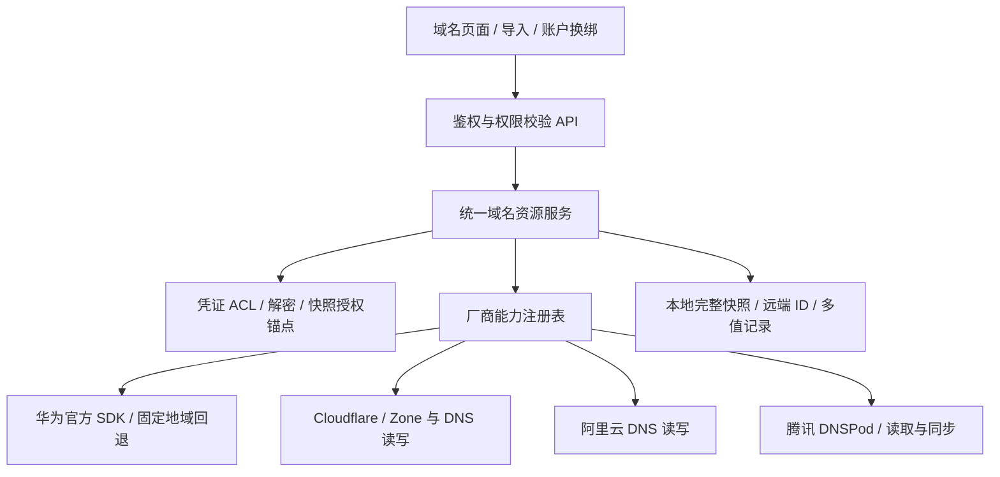

# 域名分支整合与 main 合并

日期：2026-11-05

## 来源与范围

- 本次分支：`codex/huawei-cloud-import`，包含华为 ECS / Flexus L 导入，以及域名统一适配器、华为云和 Cloudflare DNS 管理。
- 外部分支：`origin/feat/domain-account-dns-sync`，提交 `1de9ae7`。
- 外部分支与本次工作共同基于 `175c014`。采用真实双父 merge，保留两条提交历史。
- 在独立工作区解决冲突；原工作区未提交的部署配置、AGENTS 和开发计划等改动不纳入提交。

## 整合架构

沿用实施前的架构和安全审计记录：`docs/superpowers/plans/2026-11-05-dns-provider-adapters.md`。

## 冲突取舍

1. 保留统一能力注册表与资源服务，避免同一个厂商同时存在两条请求路径。
2. 华为继续用官方 SDK 签名，吸收对方的双地域回退能力（`cn-north-4`、`ap-southeast-3`）。不再引入第二套手写 HMAC 实现。
3. 引入腾讯 DNSPod 官方 SDK 的分页读取与同步；保留原始记录 ID，避免相同值的不同线路记录被去重。腾讯当前仅支持读取，前后端均禁止写入。
4. 纳入已有域名的账户绑定、换绑、解绑。新账户的 Zone 归属及全部记录读取成功后，才在同一事务里替换账户与缓存；失败保留旧账户及快照。
5. 历史子域名选择最长标签匹配的已授权 Zone，不猜测域名最后两段。
6. 纳入腾讯 SecretId / SecretKey 凭证格式兼容；厂商始终由明确选项决定，不通过凭证名称猜测。
7. 解绑保留快照并关闭云同步、写操作；`snapshot_credential_id` 保留原凭证的动态 ACL。快照也计入凭证引用数，原凭证过期不妨碍授权用户读取已有快照。

## 安全审计及修复

- 云请求限固定官方端点，TLS 验证开启、有超时、不接受用户自定义请求 URL。
- 凭证先授权再解密，云错误脱敏；不向页面返回 AK、SK、Token 或明文 SDK 异常。
- DNS 删除继续要求一次性风险票据，系统记录和不支持的类型只读。
- 独立审查实际复现解绑快照绕过凭证 ACL；已用独立授权锚点修复，并加入读取、再次换绑、过期凭证、引用数回归。
- 新增幂等迁移 `20261105_dns_snapshot_acl`，生产环境需要 `alembic upgrade head`；开发环境沿用启动补列。

## 验证口径

- 最终结果：后端 `828 passed, 1 skipped`，另有 `119 subtests passed`；Vitest `60 passed`；Playwright 桌面 `7 passed`（19 张步骤截图）。pyflakes、ESLint、TypeScript / Vite 构建全部通过。
- 独立代码审查及权限修复复审均完成，未遗留阻断项。既有依赖弃用及构建分包警告不影响通过结果。
- 后端专项、全量 pytest，pyflakes 未定义名检查，前端 ESLint、TypeScript / Vite 构建，以及前端 Vitest。
- 桌面 Playwright：华为导入/多值/增删与风险票据、Cloudflare 代理/TTL/MX、写失败保留输入、能力扩展、只读角色、解绑/重新绑定、腾讯只读同步。
- 页面截图来自本机 Vite `http://127.0.0.1:5173`，Playwright 模拟登录及云 API。它们用于验证页面交互，不代表真实云账号联调或真实 DNS 写入成功。
- GUI 测试和报告位于仓库外 `C:/Users/ppaib/.ccpulse/e2e/opspilot-dns`，未把模拟服务代码加入产品。

## 扩展性结论

域名模块现在可通过实现适配器并注册能力扩展；页面按能力展示入口。主机、证书和费用模块继续沿用《61-多云域名适配与扩展性评估》的评估，本次不扩大重构范围。
